**PROJECT 3: SIEM DEPLOYMENT**

“**SECURITY OPERATIONS REPORT”**

Compiled by: Gberemor Solomon

TechCrush no. CYBE/2026/TC-7/0747

Class: Cyber Security Class B, Cohort 7

Team Members: CYBE/2026/TC-7/0590, CYBE/2026/TC-7/0452,
CYBE/2026/TC-7/0747

Date: 21 July,2026

# INTRODUCTION 

Our team was asked to act as a newly formed security operations centre
(SOC) for an organization with no central oversight into its network. We
were tasked with deploying a security information and event management
(SIEM) solution from the ground up, using wazuh, and proving it could
collect logs from real systems and detect real attacks.

This report shows how we deployed the wazuh SIEM, connected two
endpoints: “ubuntu linux machine” and “windows 10 machine.” We however,
simulated three different attacks against those endpoints, and analysed
the logs triggered to confirm that our SIEM could detect them.

# THE PROJECT AIMS

- Deploy a central wazuh manager and connect endpoint agents to it

- Ingest windows event logs and linux syslogs/authentication logs

- Simulate at least three real-world attack vectors against our own
  endpoints

- Detect and analyze the logs and alerts generated by those attacks

- Produce a formal incident report for one of the simulated attacks

# ARCHITECTURAL TOPOLOGY

The diagram below shows the full layout of our the “SIEM” workplace. The
wazuh server, which runs the manager indexer, and dashboard, sits at the
centre and is connected to two endpoints over a virtual box host only
network.

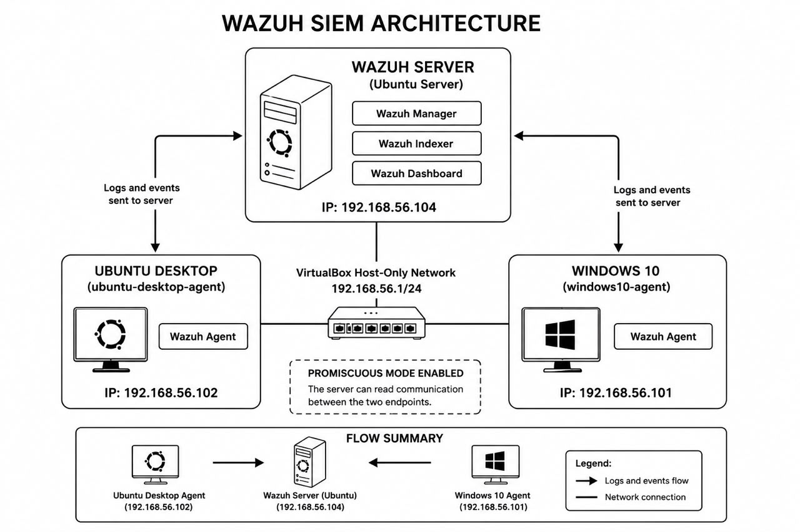

*This network diagram shows the wazuh server and both connected
endpoints, with the IP addresses*

Here, the wazuh server runs on ubuntu server at IP 192.168.56.104. It is
connected to two endpoints: the ubuntu desktop agent at IP
192.168.56.102, and the windows 10 agent at IP 192.168.56.101. Both
endpoints send their logs and events to the server over the
192.168.56.1/24 network agent. The promiscuous mode is enabled on the
network so the server can read traffic between the two endpoints.

# THE INFRASTRUCTURE and LOGS INGESTION 

We started building our infrastructure on July 17, 2026. Here, we
deployed the wazuh manager on an ubuntu server,hostname, “ubuntu server”
and connected it to two endpoints, an ubuntu desktop machine, hostname,
“ubuntu lab” and a window 10 machine, so both could forward their logs
to a single centralised dashboard.

## THE INSTALLATION PROCESS

We used oracle virtualbox to create three virtual server to act as the
wazuh manager the “ubuntu desktop machine, the windows 10 machine and
the last two acted as our endpoints.

We first installed the Wazuh manager on the ubuntu server. After
installation, we checked that the wazuh manager service was running
properly using the command sudo systemctl status wazuh manager. The
service showed as active and running, with all its core processes, such
as wazuh analysisd, wazuh remoted, and wazuh log collector, working
correctly.

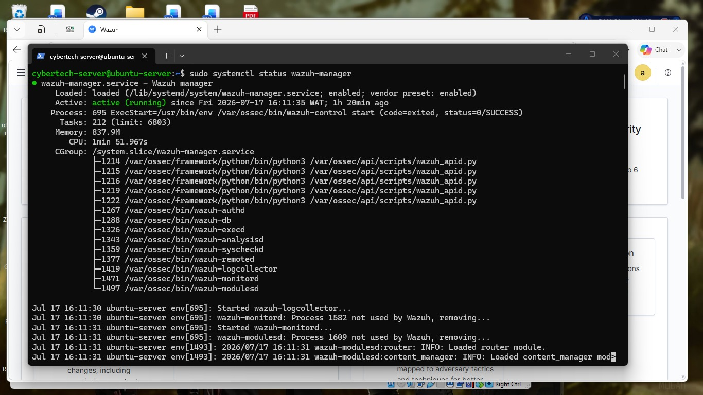

*This is the terminal output confirming that the wazuh manager service
is active and running*

We then installed the wazuh agent on both endpoints and connected them
to the manager. Then after installation, we confirmed that both agents
were active. The wazuh endpoints summary dashboard show two active
agents: ubuntu desktop agent (ID 001, IP 192.168.56.102, running uuntu
22.04.5 LTS) and windows10 agent (ID 002, IP 192.168.56.101, running
windows 10 Pro). Both agents were on version 4.14.6 and connected to the
same manager node.

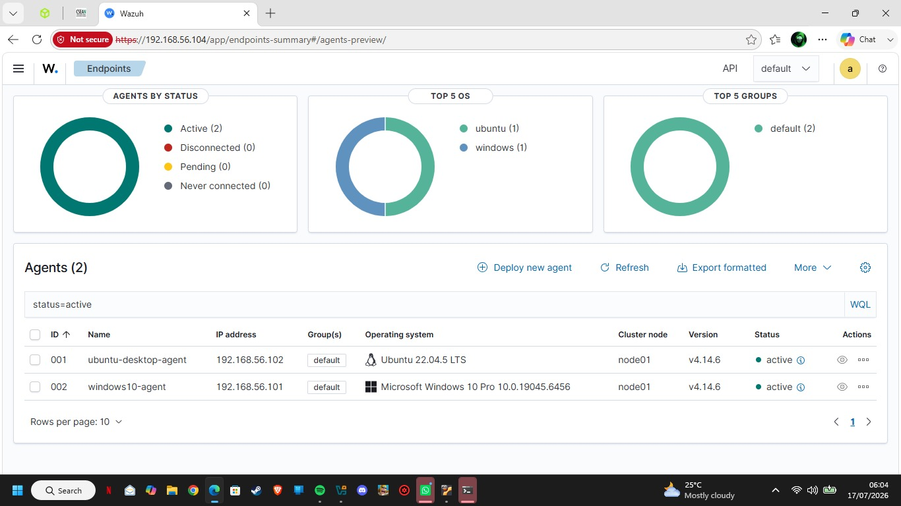

*Here is the wazuh endpoints summary dashboard showing both agents as
active*

## TELEMETRY CONFIGURATION 

On the ubuntu endpoint, we edited the agent configuration file
“ossec.config” to collect the important log files. We then added log
sources for the authentication log “/var/log/auth.log”, the system log
“/var/log/syslog”, the package installation log “/var/log/dpkg.log”, and
the active-responses log. After saving the file, we restarted the agent
using sudo systemctl restart wazuh agent and confirmed it was active and
running again.

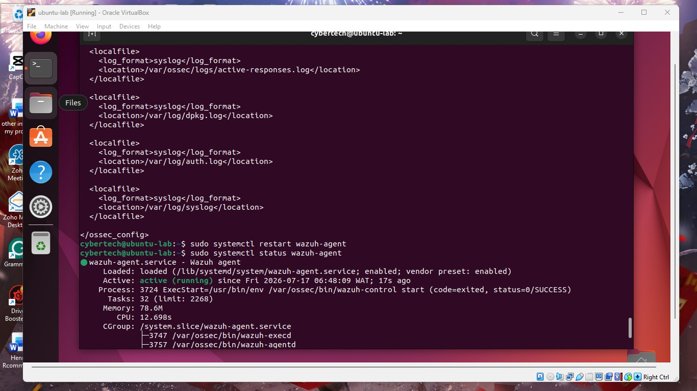

*The ubuntu agent ossec.conf showing configured log sources, and the
agent service running after restart*

Then on the windows endpoint, we edited the ossec.conf file to collect
windows event logs. We configured three log channels: “Application,
security (with a filter to remove unimportant, noisy event IDs), and
System.” This allowed the windows agent to forward important system,
application, and security events to the wazuh manager.

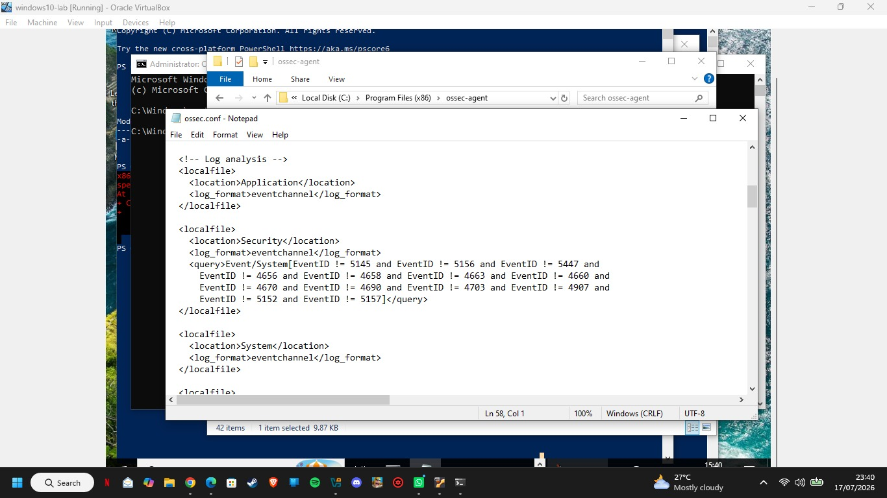

*This is the windows agent ossec.conf showing the application, security,
and system log channels configuration*

## PROOF OF INGESTION 

After configuration, we confirmed that both endpoints were sending logs
correctly by checking the wazuh threat hunting dashboard.

For the ubuntu endpoint (ubuntu desktop agent), the dashboard recorded
560 total alerts for the week, with 6 authentication failures and 50
successful authentications. The most common alert groups included
syslog, pam, sudo, and apparmor.

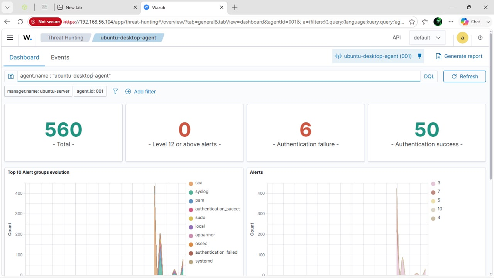

*This screenshot is the wazuh dashboard for ubuntu desktop agent showing
total alerts and authentication activities*

For the windows endpoint, “windows10 agent”, the dashboard recorded 992
total alerts for the week, with 0 authentication failures and 6
successful authentications. The most common alert groups included
windows, windows application, windows security, and policy changed.

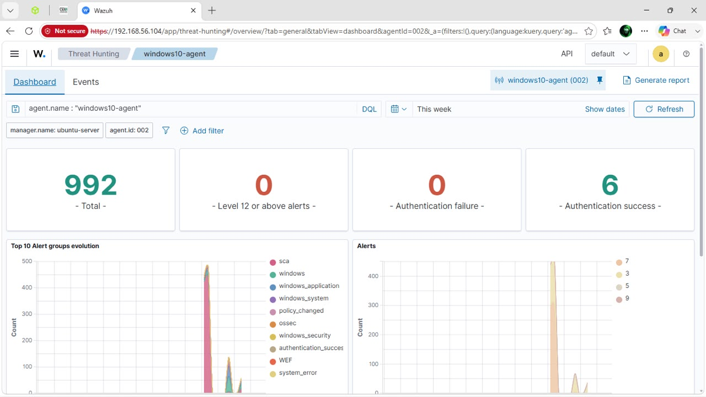

*Here is the wazuh dashboard for windows10 agent showing total alerts
and authentication activities.*

We also checked the raw event logs for both agents under the events tab.
For the ubuntu agent, we could see real log entries such as PAM login
sessions, sudo attempts, and Apparmor denials, confirming that
authentication logs and syslogs were being received rightfully.

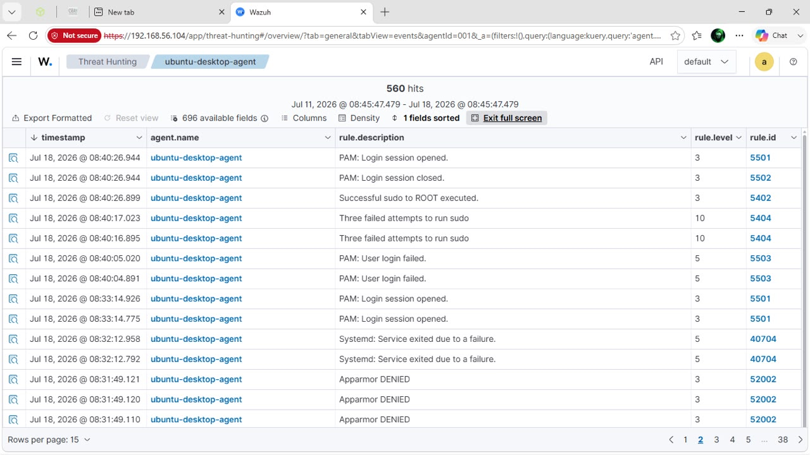

*This is the raw event log entries received from the ubuntu endpoint,
including PAM and sudo activity*

For the windows agent, we could see entries related to CIS benchmark
checks and system services, confirming that wndows event logs were being
received correctly.

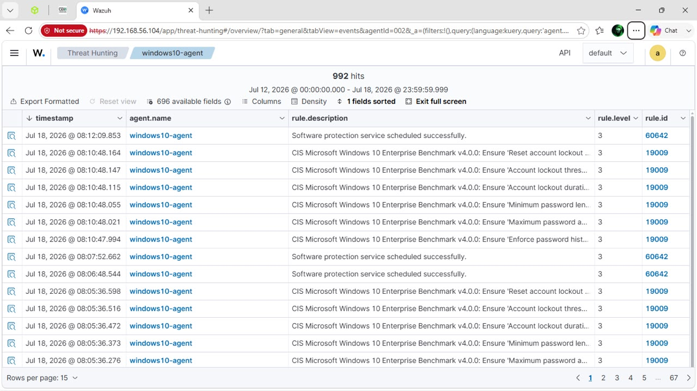

*The raw event log entries received from the windows endpoint, including
CIS benchmark checks*

Then we finally ran a Configuration assessment (SCA) scan on both
endpoints to check their security settings against CIS benchmarks. The
ubuntu endpoint scored 42% against the CIS ubuntu linux 22.04 LTS
benchmark (76 passed, 101 failed, 30 not applicable), and the windows
endpoint scored 27% against the CIS microsoft windows 10 enterprise
benchmark (115 passed, 297 failed, 12 not applicable). This confirmed
that the Wazuh manager was actively analyzing both endpoints, not just
collecting their logs.

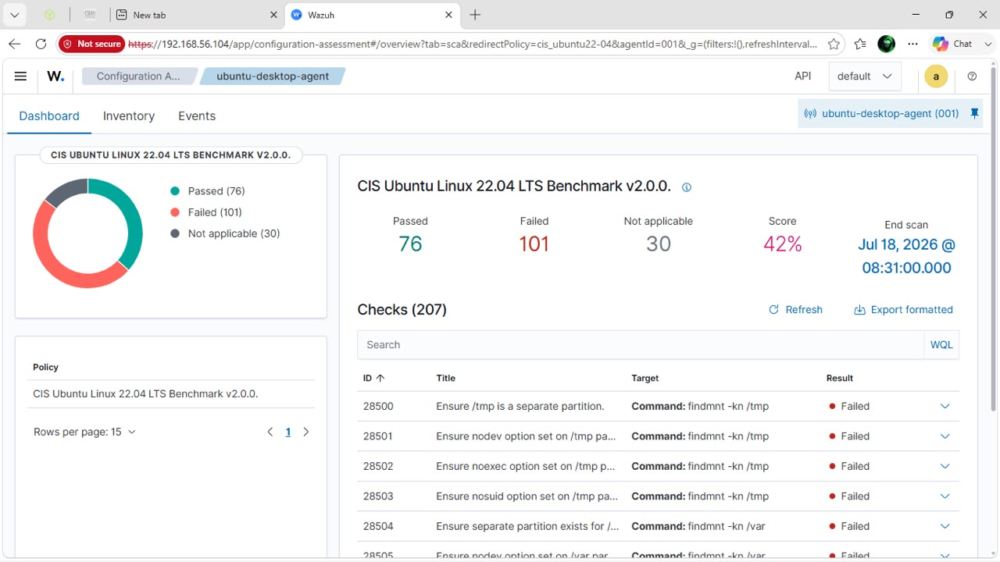

*This screenshot shows the CIS benchmark configuration assessment
results for the Ubuntu endpoint*

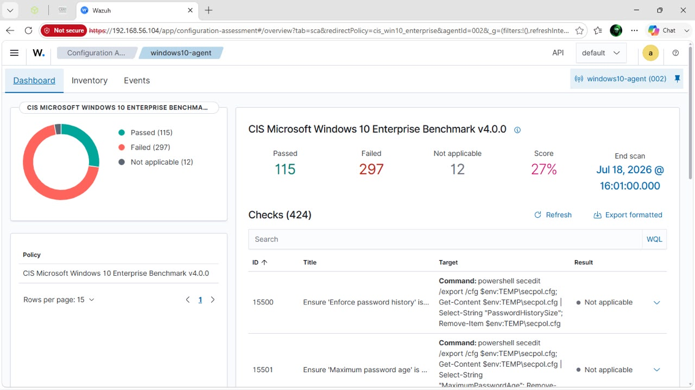

*Here is the CIS benchmark configuration assessment results for the
windows endpoint*

# ATTACK SIMULATION 

# 

Between July 18 and July 19, 2026, our team acted as the adversary and
carried out three attacks against our own endpoints: an SSH bruteforce
attempt on the ubuntu machine, a hidden administrator account created on
the windows machine, and an attempt to clear the windows security log,
to check whether wazuh could detect each one.

## The attack: “SSH bruteforce” (Linux endpoint)

On July 18, 2026, starting around 21:45, we attempted to log in to the
ubuntu desktop agent host 192.168.56.102 over SSH multiple times using
the wrong password for the cybertech account, to simulate an attacker
trying to guess valid credentials. After multiple failed attempts, one
login attempt succeeded.

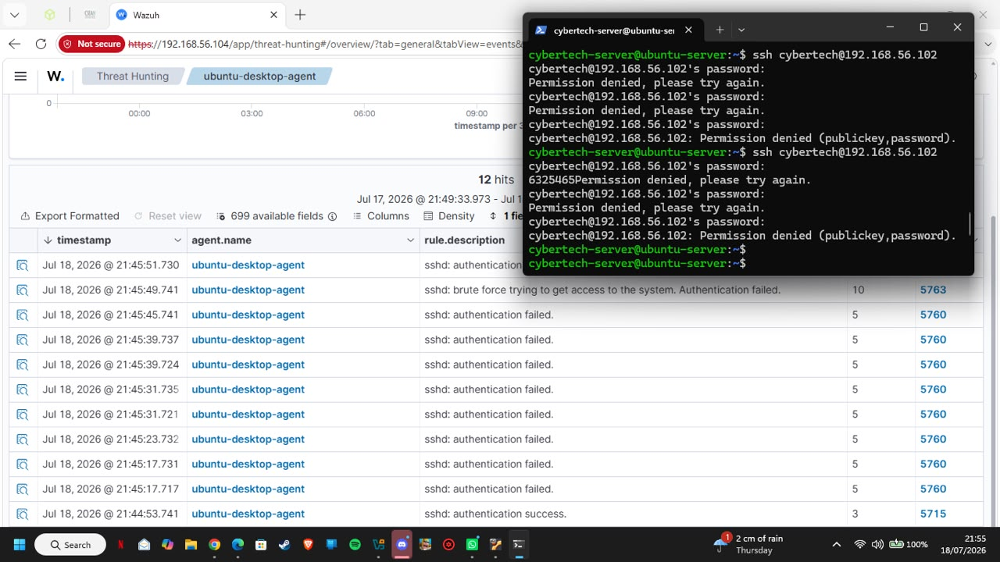

*Our terminal showing repeated failed SSH login attempts, followed by a
successful login*

Wazuh detected the repeated failed logins and correctly classified the
activity as a bruteforce attempt, mapping it to MITRE ATT&CK technique
T1110 Bruteforce under the “credential access tactic.”

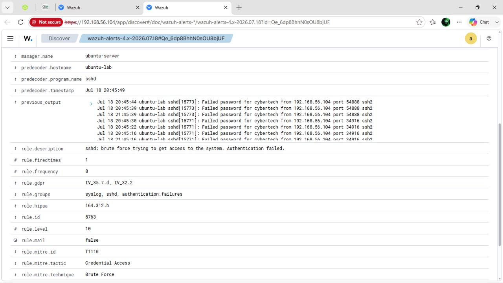

*The wazuh alert detail showing the bruteforce detection and its MITRE
ATT&CK mapping*

## The attack: “hidden local administrator account creation.” \[windows endpoint\]

On July 19, 2026, at 09:30, on the windows10 agent host, we created a
hidden local account (hiddenadmin1) using the command net user
hiddenadmin1 p@ssw0rd123 /add, then added it to the local administrators
group using net local group administrators hiddenadmin1 /add. This
simulates an attacker planting a backdoor account for future access.

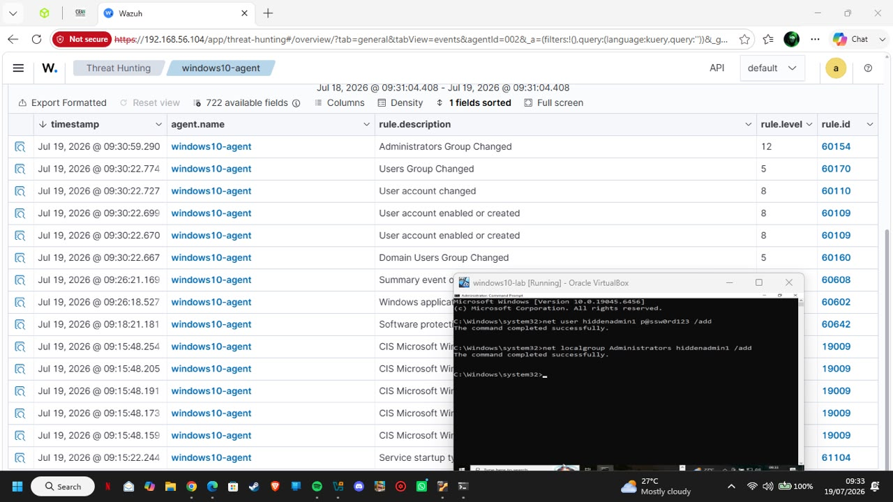

*This is the command execution creating the hidden account and adding it
to the administrators group, with the resulting wazuh alerts*

Here,wazuh detected both actions: the creation of the account triggered
an alert for 'user account enabled or created, and adding it to the
administrators group triggered a higher severity alert for
“administrators group changed.” Wazuh mapped this to MITRE ATT&CK
technique T1098 (account manipulation) under the persistence tactic.

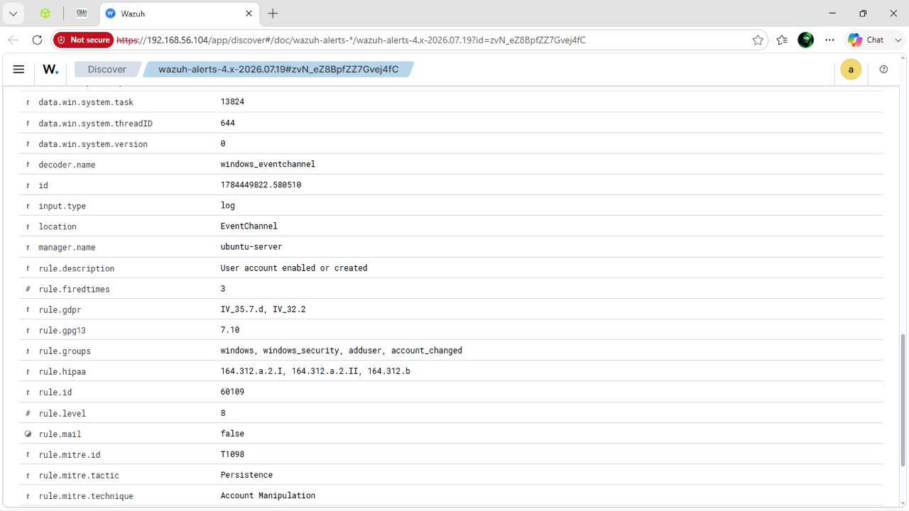

*Here is the wazuh alert detail showing the account manipulation
detection and its MITRE ATT&CK mapping*

## The attack: “clearing windows event logs. (defence evasion)

Later that day, on the same windows10 agent host, we simulated an
attacker covering their tracks. We deleted the hidden account, then
attempted to clear the Windows security event log. Our first attempt
used the clear command, which is not valid in windows command prompt. We
then used the correct windows command, wevtutil cl security, which
successfully cleared the log at 09:45.

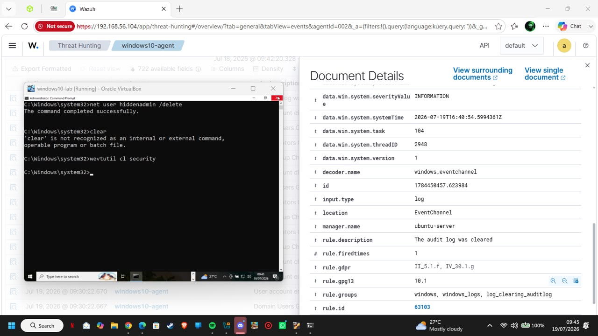

*The terminal showing the account deletion and the command used to clear
the windows security logs*

Even though the log was cleared, Wazuh still detected the clearing
action itself, generating an alert stating “The audit log was cleared,”
along with the account name and computer name responsible for the
action. This shows that Wazuh can catch defence evasion attempts, not
just the original attack.

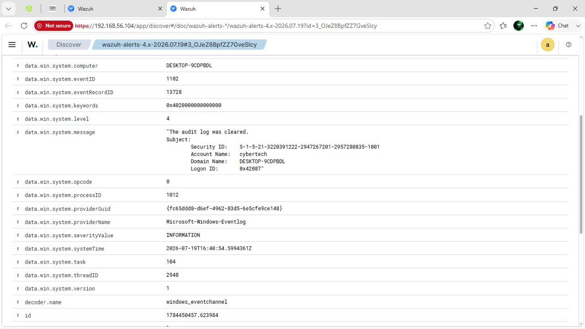

*The Wazuh alert detail confirming detection of the Security log being
cleared*

# Detection engineering and formal incident report

All the three simulated attacks were successfully detected by wazuh. For
a deeper, formal analysis, our team selected the hidden local
administrator account attack, since it best demonstrates an attacker
gaining a persistent foothold rather than just a single suspicious
action.

## Selected incident

Hidden local administrator account creation on the windows 10 endpoint
(windows10 agent).

## MITRE ATT&CK mapping

Tactic: “persistence”

Technique: T1098 account manipulation

**Raw log evidence**

Wazuh recorded two key events for this incident. The first was rule ID
60109 "user account enabled or created", severity level 8, generated
when the hiddenadmin1 account was created. The second was rule ID 60154
"administrators group changed", severity level 12, generated when the
account was added to the local administrators group. Both events are
shown in the screenshots under the hidden local administrator account
creation attack above.

## The attack timeline

At 09:29:00 The attacker gains local access to the windows10 agent host
assumed foothold; no prior phishing or RDP step was simulated in this
lab.

09:30:22 The attacker runs net user hiddenadmin1 p@ssw0rd123 /add,
creating a hidden local account. wazuh generates rule 60109 ("User
account enabled or created," level 8).

09:30:59 The attacker runs net localgroup administrators hiddenadmin1
/add, elevating the account to local administrator. Wazuh generates Rule
60154 "administrators grou59 changed," level 12.

Post incident - If left undetected, the account would remain as a
hidden, privileged backdoor available for future access. In our lab, the
same session later included an attempt to remove the account and clear
the security log, which wazuh also detected as seen in the windows
security logs clearing attack above.

## Remediation/ recommendations

- Restrict local account creation: limit who can run net user and net
  localgroup by enforcing this through group policy, so only authorized
  administrators can create or modify accounts.

- Enable real-time alerting on wazuh rules 60109 and 60154 so a SOC
  analyst is notified immediately when a new account is created or added
  to an administrator group.

- Regularly audit local administrators group membership on all endpoints
  to catch unauthorized additions early.

- Protect windows event logs from tampering, e.g by forwarding logs to a
  separate, write protected location, so clearing a local log does not
  destroy the evidence.

- Use an EDR or application whitelisting tool to block execution of
  account-management commands like net user and net localgroup by
  unauthorized users or processes.

- Require multi-factor authentication (MFA) for any action that changes
  administrator group membership.

# Challenges and resolutions

During the SSH brute-force test, our first several login attempts
returned “permission denied" because we were not yet using the correct
password for the target account. We resolved this by confirming the
correct test credentials, after which the repeated failed attempts were
correctly logged and later followed by a successful login, which
triggered wazuh's bruteforce detection rule.

During the log clearing test, our first command, clear, failed because
it is a linux/powershell command and is not recognized in the windows
command prompt. We then resolved this by using the correct windows
equivalent, wevtutil cl security, which successfully cleared the
Security log and was still picked up by wazuh.

# Conclusion

Our team successfully deployed a working wazuh SIEM environment from
scratch, connected one linux and one windows endpoint, and confirmed
that logs from both systems were being collected and analyzed correctly.
We simulated three different attack vectors: SSH bruteforce, hidden
administrator account creation, and windows security log clearing, and
wazuh successfully detected all three, correctly mapping two of them to
their MITRE ATT&CK techniques.

This confirms that our SIEM deployment meets the goal set by the CISO.
It can ingest data from company operating systems and reliably detect
real world attack behaviour. One limitation we noted is that both
endpoints scored low on their CIS benchmark scans (behaviour ubuntu, 27%
for windows), meaning the underlying systems still have many hardening
gaps. Future work should focus on remediating these configuration
weaknesses in addition to monitoring for attacks.
